# CustomerLens

**CustomerLens — Customer Segmentation Using K-Means and K-Medoids Clustering with Optimal-K Selection and Interactive Analytics**

Data Mining and Data Warehousing (BTCO14505) · Open Ended Project (OEP)
Department of Computer Engineering · Sarvajanik College of Engineering & Technology (SCET), Sarvajanik University, Surat · B.Tech Semester V · Div III · AY 2025–26

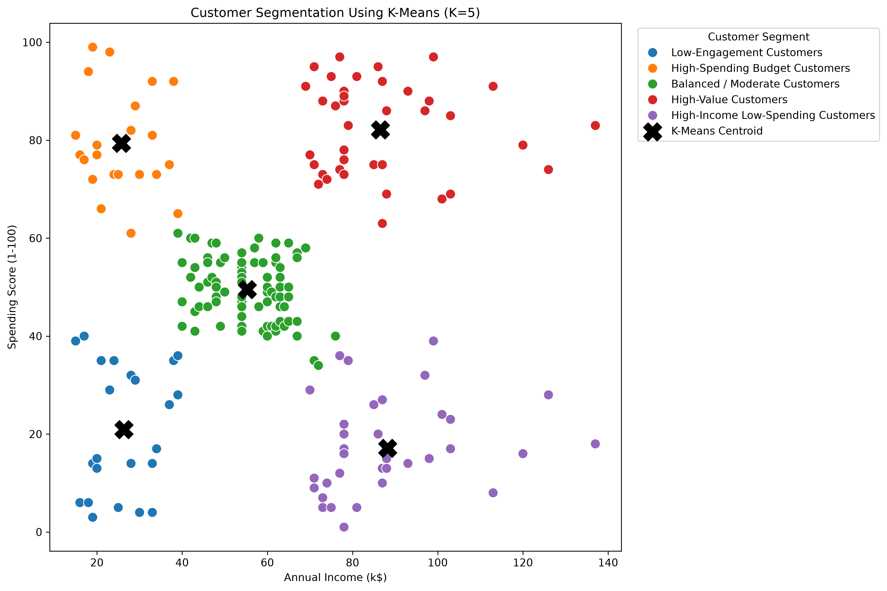

*Annual Income (k$) vs Spending Score (1-100), colour-coded by K-Means segment; black crosses are centroids. Generated by the project notebook.*

> **Read before interpreting any result**
> - **Spending Score is a behavioural score supplied by the dataset.** The repository does not document how it was computed, and it is not measured monetary expenditure.
> - **Segment names are descriptive labels** attached by the team to cluster averages. They are not ground-truth customer categories.
> - **Runtimes are single-run values** from one implementation. They do not show that one algorithm is generally faster.
> - **Adjusted Rand Index (ARI) is agreement between two clusterings.** It is not accuracy.

---

## Table of contents

1. [Overview and motivation](#1-overview-and-motivation)
2. [Objectives and implemented capabilities](#2-objectives-and-implemented-capabilities)
3. [Visual preview](#3-visual-preview)
4. [Dataset and schema](#4-dataset-and-schema)
5. [Technology stack](#5-technology-stack)
6. [Architecture and data flow](#6-architecture-and-data-flow)
7. [Repository structure](#7-repository-structure)
8. [Data preprocessing](#8-data-preprocessing)
9. [Clustering methodology](#9-clustering-methodology)
10. [Optimal-K selection and evaluation metrics](#10-optimal-k-selection-and-evaluation-metrics)
11. [Results and cluster interpretation](#11-results-and-cluster-interpretation)
12. [Streamlit application](#12-streamlit-application)
13. [React frontend](#13-react-frontend)
14. [MCP server and optional utilities](#14-mcp-server-and-optional-utilities)
15. [Installation and setup](#15-installation-and-setup)
16. [How to run each component](#16-how-to-run-each-component)
17. [Regenerating outputs and artifacts](#17-regenerating-outputs-and-artifacts)
18. [Testing and validation](#18-testing-and-validation)
19. [Academic relevance](#19-academic-relevance)
20. [Limitations and known issues](#20-limitations-and-known-issues)
21. [Troubleshooting](#21-troubleshooting)
22. [Data attribution and acknowledgements](#22-data-attribution-and-acknowledgements)
23. [Future improvements](#23-future-improvements)
24. [Team](#24-team)

---

## 1. Overview and motivation

Customers differ in income and engagement, and treating all of them as one group hides structure that matters for marketing and customer management. The dataset used here has **no predefined customer categories**, so the task is **unsupervised**: groups are discovered from similarity between customers instead of being predicted from labels.

CustomerLens clusters **200 mall customers** using two features, **Annual Income (k$)** and **Spending Score (1-100)**, with two algorithms on the same standardised data:

- **K-Means**: groups customers around centroids (cluster means).
- **K-Medoids (PAM)**: groups customers around medoids (actual customers used as cluster centres).

It evaluates K = 2 to 10, selects **K = 5**, compares the two algorithms, profiles each segment, and presents the stored results in a **Streamlit** app and a **React** dashboard.

The project describes the existing 200 customers. It does **not** predict future behaviour, and it has not been tested against any business outcome.

---

## 2. Objectives and implemented capabilities

| OEP requirement | How the repository covers it | Evidence |
|---|---|---|
| Preprocessing | Missing-value and duplicate audit, feature selection, `StandardScaler` | notebook, `artifacts/models/scaler.joblib` |
| Clustering | K-Means and K-Medoids at K = 5 | `artifacts/models/`, `data/processed/` |
| K-Means | scikit-learn `KMeans` | notebook |
| K-Medoids | custom NumPy implementation of PAM | notebook (`pam_kmedoids`) |
| Elbow / bend-in-the-knee for K | K-Means inertia and K-Medoids medoid-cost curves for K = 2…10, **judged by eye** (no automated knee detection), plus silhouette and Davies-Bouldin | notebook, both apps |
| 2D Income vs Spending Score scatter, colour-coded by cluster | Matplotlib figure with centroids; interactive versions in both apps | `artifacts/figures/kmeans_customer_segmentation.png`, *Cluster Explorer* pages |

Beyond the brief: cluster profiling, silhouette / Davies-Bouldin / ARI comparison, descriptive segments, a seven-page Streamlit app, a seven-page React dashboard, eight automated tests, and an optional MCP helper server.

---

## 3. Visual preview

**Optimal-K evidence** (silhouette, Davies-Bouldin, K-Means inertia and K-Medoids cost for K = 2…10; inertia and medoid cost are in separate panels because they are different objectives):

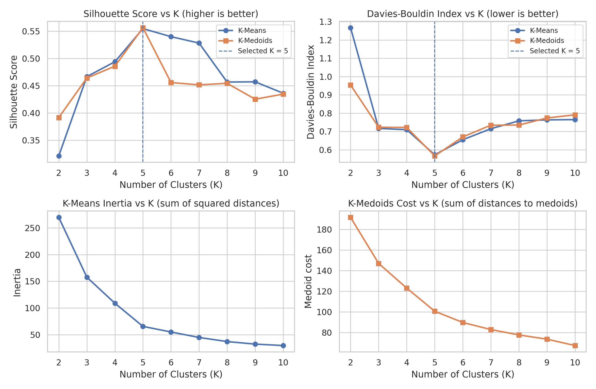

**Dataset overview and exploratory analysis:**

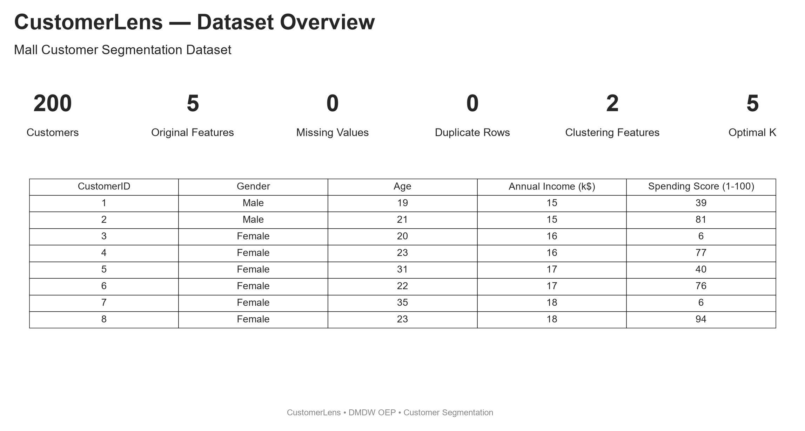
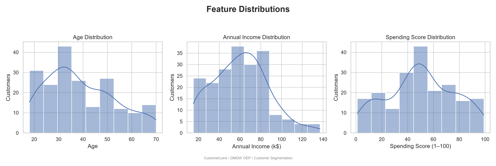
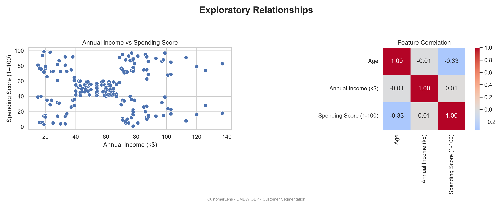

**Cluster sizes and averages (K-Means segments):**

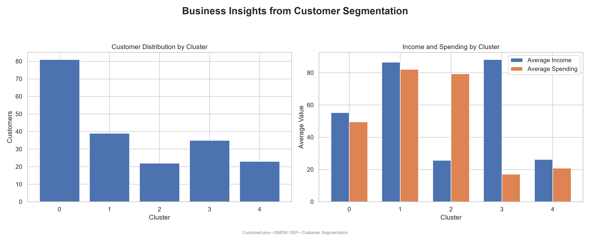

> **Not shown here.** The archive does not contain `artifacts/screenshots/`, so no React or Streamlit screenshots are linked. They are produced by the optional runners in `mcp-server/` (see [§14](#14-mcp-server-and-optional-utilities)); add them to this README after generating them.
>
> `artifacts/ppt_assets/06_cluster_profile.png` (blank left half) and `07_algorithm_comparison.png` (runtime panel shows only K-Means) have visible defects and are deliberately not embedded; see [§20](#20-limitations-and-known-issues).

---

## 4. Dataset and schema

| Item | Value (computed from `data/raw/Mall_Customers.csv`) |
|---|---|
| Records / columns | 200 / 5 |
| Missing values | 0 |
| Duplicates | 0 duplicate rows, 0 duplicate `CustomerID` |
| Gender | 112 female, 88 male |
| Age | 18–70, mean 38.85 |
| Annual Income (k$) | 15–137, mean 60.56 |
| Spending Score (1-100) | 1–99, mean 50.20 |

| Column | Type | Meaning | Role |
|---|---|---|---|
| `CustomerID` | integer | customer identifier | identifier only, **excluded** from clustering |
| `Gender` | categorical | Male / Female | profiling after clustering |
| `Age` | integer | age in years | profiling after clustering |
| `Annual Income (k$)` | numeric | annual income in thousands of dollars | **clustering feature** |
| `Spending Score (1-100)` | numeric | score from 1 to 100 supplied by the dataset | **clustering feature** |

**Why separate identifier, features and profiling variables.** An identifier carries no behavioural meaning and would only add noise to distances. Demographics (Gender, Age) are kept out of the clustering so they can be used afterwards to *describe* the groups, not to *form* them. The clustering features are stored in `artifacts/models/feature_config.joblib` as `['Annual Income (k$)', 'Spending Score (1-100)']`, and one of the tests asserts this.

**Processed files** (`data/processed/`):

| File | Content | Consumed by |
|---|---|---|
| `customers_audited.csv` | the five raw columns after the audit | not read by the application code |
| `clustering_features_scaled.csv` | the two standardised features | not read by the application code |
| `customers_with_cluster_assignments.csv` | raw columns + `KMeans_Cluster`, `KMedoids_Cluster` | not read by the application code |
| `final_customer_segmentation.csv` | assignments + segment names | not read by the application code |
| `customerlens_final.csv` | same contents as `final_customer_segmentation.csv` | `app.py`, `export_frontend_data.py`, tests |

---

## 5. Technology stack

| Layer | Technology | Role in this project |
|---|---|---|
| Language | Python | analysis, Streamlit app, export scripts, tests |
| Data | pandas, NumPy | tables, grouping, array maths; PAM is written in NumPy |
| Machine learning | scikit-learn | `StandardScaler`, `KMeans`, `silhouette_score`, `davies_bouldin_score`, `adjusted_rand_score`, `pairwise_distances` |
| Persistence | joblib | saves and loads the scaler, K-Means model, medoid data and feature config |
| Plots | Matplotlib, Seaborn | static figures; Streamlit charts are drawn with Matplotlib via `st.pyplot` |
| Notebook | Jupyter (JupyterLab) | `notebooks/01_data_audit_and_eda.ipynb` |
| App 1 | Streamlit | `app.py` |
| App 2 | React 19, TypeScript 6, Vite 8 | `frontend/` |
| Styling / UI | Tailwind CSS 4, shadcn-style components on Base UI (`@base-ui/react`), `class-variance-authority`, `lucide-react`, Geist font | dashboard UI |
| Charts (React) | Recharts 3 | scatter, bar and line charts |
| Quality | pytest, ESLint 10 + typescript-eslint | tests and lint |
| Optional | MCP (`mcp[cli]`), Playwright | `mcp-server/` helper tooling |

Pinned Python versions in `requirements.txt` include pandas 3.0.6, NumPy 2.4.6, scikit-learn 1.9.1, SciPy 1.17.1, Matplotlib 3.11.2, Seaborn 0.13.2, joblib 1.6.0, Streamlit 1.66.1, JupyterLab 4.6.4. The project does not pin a Python version or a Node.js version; Vite 8 requires Node.js `^20.19.0 || >=22.12.0`.

> **Declared but unused.** `frontend/package.json` lists `gsap`, `lenis`, `motion`, `sonner` and `@tanstack/react-table`, but no file in `frontend/src/` imports them (checked by search). They are not features of the application.

---

## 6. Architecture and data flow

CustomerLens is a **batch analysis plus two read-only viewers**. All clustering is done in the notebook. The Streamlit app and the React app only read stored files. **The two dashboard applications do not use a dedicated application backend, database, or authentication system. Streamlit reads local datasets and saved artifacts, while the React dashboard reads exported static JSON. The optional MCP server is a separate developer-integration utility.**

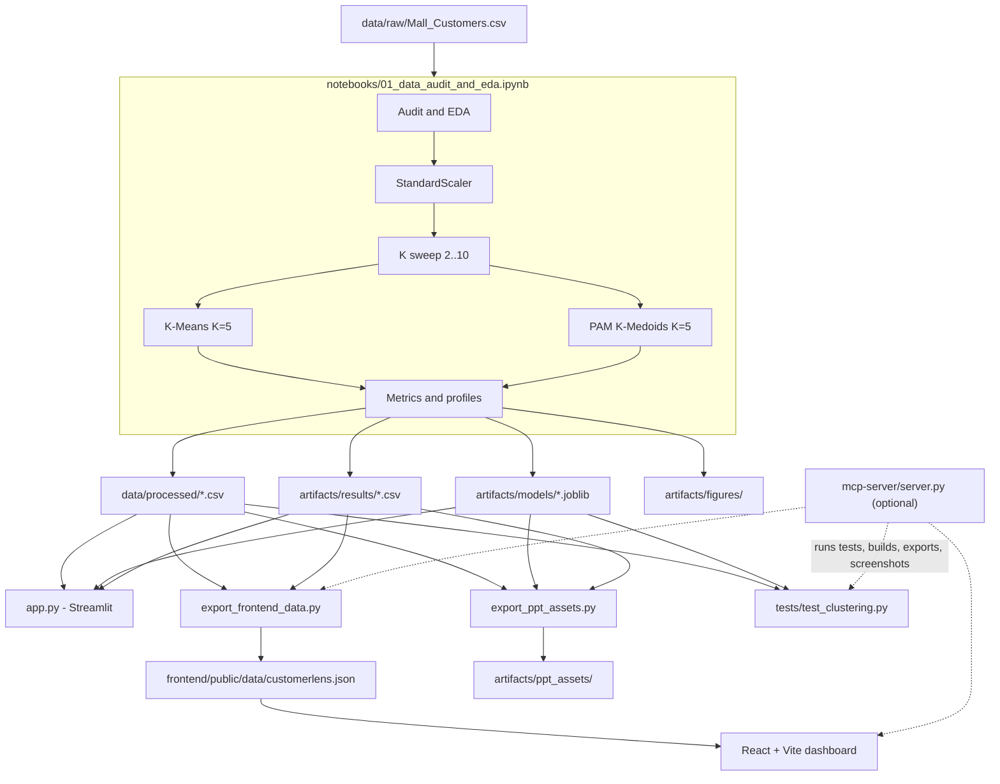

**Which file reads what** (verified from the source):

| Component | Reads |
|---|---|
| `app.py` | `data/processed/customerlens_final.csv`; the four `.joblib` files; `kmeans_optimal_k_results.csv`, `kmedoids_optimal_k_results.csv`. It computes cluster profiles, silhouette, Davies-Bouldin and ARI itself. |
| `export_frontend_data.py` | `customerlens_final.csv` and six CSVs in `artifacts/results/` (see §13) |
| `export_ppt_assets.py` | the processed CSV, models and result CSVs; writes `artifacts/ppt_assets/` |
| `tests/test_clustering.py` | `customerlens_final.csv` and the four `.joblib` files |
| React app | only `/data/customerlens.json` (static file) |

`segment_business_insights.csv` and `cluster_assignment_comparison.csv` are written by the notebook but not read by `app.py`, the export scripts or the frontend.

---

## 7. Repository structure

```text
CustomerLens/
├── app.py                          # Streamlit app (3,051 lines, seven pages)
├── export_frontend_data.py         # results CSVs -> frontend/public/data/customerlens.json
├── export_ppt_assets.py            # builds artifacts/ppt_assets/*
├── requirements.txt                # pip freeze (UTF-16 LE with BOM in this archive)
├── .gitignore
├── data/
│   ├── raw/Mall_Customers.csv
│   └── processed/                  # five CSVs (see §4)
├── artifacts/
│   ├── models/                     # scaler, kmeans_k5, kmedoids_pam_k5, feature_config (.joblib)
│   ├── results/                    # eight CSVs (optimal-K, profiles, comparison, insights)
│   ├── figures/                    # kmeans_customer_segmentation.png
│   └── ppt_assets/                 # 01..09 PNG + 04_optimal_k_corrected.png
├── notebooks/
│   └── 01_data_audit_and_eda.ipynb # the full analysis (81 code cells, no markdown cells)
├── frontend/                       # React + TypeScript + Vite
│   ├── package.json, package-lock.json, vite.config.ts, eslint.config.js,
│   │   components.json, tsconfig*.json
│   ├── public/data/customerlens.json
│   └── src/
│       ├── main.tsx, App.tsx, index.css
│       ├── components/{layout,charts,ui}/
│       ├── pages/                  # six lazy-loaded pages (Overview is inside AppShell.tsx)
│       ├── data/customerlens.ts    # types + fetch
│       ├── hooks/                  # use-customerlens-data.ts, use-mobile.ts
│       └── lib/                    # cluster-colors.ts, utils.ts
├── mcp-server/                     # server.py, screenshot runners, ppt_asset_extractor.py,
│                                   # mcp-config.example.json, requirements.txt
├── skills/customerlens/SKILL.md
├── presentation/                   # OEP presentation (.pptx) and report (.pdf)
├── src/__init__.py                 # empty package
└── tests/test_clustering.py        # eight tests
```

### Important modules

| File | Responsibility |
|---|---|
| `app.py` | loads data/models, draws all seven Streamlit pages, assigns hypothetical customers to the nearest cluster |
| `export_frontend_data.py` | converts CSVs to one JSON file for the frontend |
| `export_ppt_assets.py` | draws figures `01`–`09` for the presentation (also re-creates the older `04_optimal_k.png`) |
| `frontend/src/data/customerlens.ts` | TypeScript types of the JSON and `loadCustomerLensData()` |
| `frontend/src/hooks/use-customerlens-data.ts` | loading / error state around the fetch |
| `frontend/src/components/layout/AppShell.tsx` | sidebar, page switching, the Overview page |
| `frontend/src/components/charts/` | `ClusterScatterChart`, `ClusterProfileChart` |
| `mcp-server/server.py` | MCP tools for tests, builds, export, git status, screenshots |

---

## 8. Data preprocessing

Implemented in the notebook (all values from the files above):

1. **Missing values:** checked with `isnull()`; none found.
2. **Duplicates:** checked on rows and on `CustomerID`; none found.
3. **Feature selection:** `Annual Income (k$)` and `Spending Score (1-100)`; `CustomerID` is excluded; Gender and Age are kept for profiling.
4. **Scaling:** `StandardScaler` is fitted on the two selected features and applied to them (`z = (x − mean) / standard deviation`). The fitted scaler is saved as `artifacts/models/scaler.joblib`.
5. **No train/test split:** the problem is unsupervised.

The **same scaled matrix** feeds K-Means, PAM and every metric. Scaling matters because both algorithms use Euclidean distance and the two features have different ranges. Plots use the original units; scaling is used only for computation.

No imputation, deduplication, encoding or outlier handling is implemented, because none was needed or coded.

**How the apps use the preprocessing.** `app.py` loads `scaler.joblib` to transform a hypothetical customer's inputs before assigning a cluster. The React app never sees raw features: it reads the exported labels and already-computed profiles.

---

## 9. Clustering methodology

### 9.1 K-Means

Each cluster is represented by its **centroid** (the mean of its members). The algorithm repeats two steps until assignments stop changing.

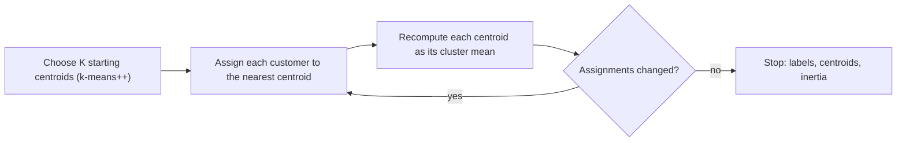

- **Objective (inertia):** sum of squared Euclidean distances from each point to its centroid.
- **Settings (verified from the saved model):** `n_clusters=5`, `init="k-means++"`, `n_init=20`, `random_state=42`. `n_init=20` means 20 independent starts; the best is kept.
- **Result at K = 5:** inertia 65.5684, saved as `artifacts/models/kmeans_k5.joblib`.

### 9.2 K-Medoids with PAM

Each cluster is represented by a **medoid**: an actual customer. PAM (Partitioning Around Medoids) searches for the K customers that minimise the total distance from everyone to their nearest medoid.

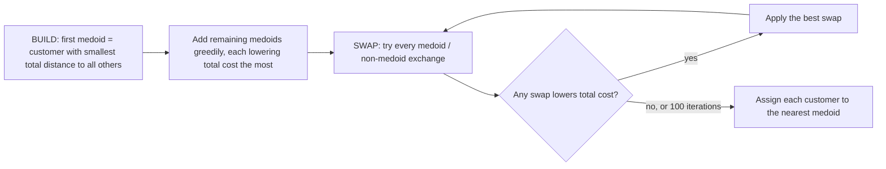

- **Objective (medoid cost):** sum of Euclidean distances (not squared) from each point to its nearest medoid.
- **Implementation:** the function `pam_kmedoids` in the notebook, with `max_iter=100`. It reads a global precomputed pairwise Euclidean distance matrix of the scaled features, so that matrix must be defined first. There is no random initialisation, so the result is deterministic.
- **Result at K = 5:** cost 100.7204; medoid customers `CustomerID` **81, 162, 177, 16, 25**.
- **Saved artifact** `kmedoids_pam_k5.joblib`: a dictionary with `k`, `medoid_indices` and `medoid_points_scaled`.
- The PAM routine exists **only in the notebook**; `app.py` loads the saved medoids and assigns each customer to the nearest one.

### 9.3 Side by side

| | K-Means | K-Medoids (PAM) |
|---|---|---|
| Cluster centre | centroid (mean; need not be a real customer) | medoid (a real customer) |
| Objective | within-cluster sum of **squared** distances (inertia) | sum of distances to the nearest medoid (medoid cost) |
| Initialisation | k-means++, 20 restarts, seed 42 | BUILD (deterministic) |
| Implementation | scikit-learn | custom NumPy |

---

## 10. Optimal-K selection and evaluation metrics

**Candidate K:** 2, 3, …, 10, evaluated separately for both algorithms. For each K the notebook records the algorithm-specific objective, the silhouette score and the Davies-Bouldin index.

Davies–Bouldin evaluates the resulting cluster partitions using cluster-centroid separation and within-cluster scatter. For K-Medoids, it does not directly measure distances to the saved medoids, so it should be interpreted as a partition-quality metric rather than the algorithm's own optimization objective.

| K | Silhouette K-Means | Silhouette K-Medoids | DB K-Means | DB K-Medoids | K-Means inertia | K-Medoids cost |
|--:|--:|--:|--:|--:|--:|--:|
| 2 | 0.3213 | 0.3916 | 1.2670 | 0.9540 | 269.69 | 191.62 |
| 3 | 0.4666 | 0.4641 | 0.7165 | 0.7230 | 157.70 | 147.04 |
| 4 | 0.4939 | 0.4857 | 0.7096 | 0.7218 | 108.92 | 123.15 |
| **5** | **0.5547** | **0.5562** | **0.5722** | **0.5661** | **65.57** | **100.72** |
| 6 | 0.5399 | 0.4558 | 0.6546 | 0.6700 | 55.06 | 89.85 |
| 7 | 0.5281 | 0.4516 | 0.7148 | 0.7341 | 44.86 | 82.99 |
| 8 | 0.4567 | 0.4544 | 0.7579 | 0.7349 | 37.15 | 77.77 |
| 9 | 0.4571 | 0.4252 | 0.7632 | 0.7736 | 32.39 | 73.67 |
| 10 | 0.4362 | 0.4347 | 0.7645 | 0.7909 | 29.69 | 67.49 |

Source: `kmeans_optimal_k_results.csv`, `kmedoids_optimal_k_results.csv` (rounded here).

**How K = 5 was selected.** The notebook prints the K with the highest silhouette (`idxmax`) and the lowest Davies-Bouldin (`idxmin`); both are **5 for both algorithms**. `OPTIMAL_K = 5` is then assigned manually, and the saved `feature_config.joblib` records `optimal_k = 5`. K = 5 is therefore the **best-scoring evaluated K for this dataset and setup**, not a universal answer.

| Measure | What it tells you | Limitation |
|---|---|---|
| **Inertia** (K-Means) | compactness around centroids; always falls as K grows | no minimum to pick; the "elbow" is a judgement |
| **Medoid cost** (PAM) | total distance to medoids; also falls as K grows | same; and a different quantity from inertia |
| **Silhouette** | `s = (b − a) / max(a, b)` per customer, averaged: `a` = mean distance to own cluster, `b` = mean distance to the nearest other cluster. −1 to 1, higher is better. | internal measure; favours compact, well-separated clusters |
| **Davies-Bouldin** | average, over clusters, of the worst ratio of (spread of two clusters) to (distance between them). Lower is better. | internal measure; tied to centroid-style geometry |

**Why not the elbow alone?** Both objective curves decrease steadily and only bend near K = 5, so reading the elbow is subjective. Silhouette and Davies-Bouldin give an independent, numeric check, and here all three point to K = 5.

**Inertia and medoid cost are different objectives** (squared distances to centroids vs plain distances to medoids). Their values must not be compared with each other, and this project does not do so.

---

## 11. Results and cluster interpretation

### 11.1 Final comparison at K = 5

| Measure | K-Means | K-Medoids (PAM) |
|---|--:|--:|
| Silhouette | 0.554657 | 0.556218 |
| Davies-Bouldin | 0.572236 | 0.566089 |
| Objective (different quantities) | inertia 65.5684 | medoid cost 100.7204 |
| Recorded runtime* | 0.164474 s | 0.076011 s |

**ARI between the two partitions: 0.9597.** The Adjusted Rand Index measures how similar two clusterings of the same customers are, corrected for chance (1 = identical, about 0 = chance). It is **not accuracy**: there are no ground-truth labels.

**Matching assignments: 197 of 200.** Cluster IDs are arbitrary, so the two label sets must be aligned before they are compared. `cluster_assignment_comparison.csv` is that alignment (K-Means rows × K-Medoids columns):

| K-Means cluster | → K-Medoids 0 | 1 | 2 | 3 | 4 |
|--:|--:|--:|--:|--:|--:|
| 0 | 81 | 0 | 0 | 0 | 0 |
| 1 | 0 | 39 | 0 | 0 | 0 |
| 2 | 1 | 0 | 0 | 21 | 0 |
| 3 | 0 | 0 | 35 | 0 | 0 |
| 4 | 2 | 0 | 0 | 0 | 21 |

Three low-income customers (`CustomerID` 41, 43, 46) are placed by K-Means in cluster 2 or 4 and by K-Medoids in its large central cluster.

**Reading the numbers**
- K-Medoids scored marginally higher on silhouette and marginally lower on Davies-Bouldin. The differences are small and apply to this dataset and setup. They do not make either algorithm better in general; the two solutions are almost the same.
- \*The runtimes were recorded in one notebook run and are **hard-coded** in `app.py`, the React page and `export_ppt_assets.py`. K-Means was timed with 20 restarts (fit only). The PAM timing covers `pam_kmedoids` only and **excludes** the pairwise distance-matrix computation. Hardware and implementation also matter. They cannot support a statement that K-Medoids is faster.
- In this audit, silhouette, Davies-Bouldin, ARI, both objectives and the medoid IDs were recomputed from the repository's own model files and CSVs and match the values above.

### 11.2 Cluster profiles

K-Means, from `artifacts/results/final_business_segment_profile.csv`:

| Cluster | Segment label | Customers | Share | Avg age | Avg income (k$) | Avg spending score |
|--:|---|--:|--:|--:|--:|--:|
| 0 | Balanced / Moderate Customers | 81 | 40.5% | 42.72 | 55.30 | 49.52 |
| 1 | High-Value Customers | 39 | 19.5% | 32.69 | 86.54 | 82.13 |
| 2 | High-Spending Budget Customers | 22 | 11.0% | 25.27 | 25.73 | 79.36 |
| 3 | High-Income Low-Spending Customers | 35 | 17.5% | 41.11 | 88.20 | 17.11 |
| 4 | Low-Engagement Customers | 23 | 11.5% | 45.22 | 26.30 | 20.91 |

K-Medoids profile (`kmedoids_cluster_profiles.csv`; IDs are independent of K-Means IDs): 84 customers (income 54.70, spending 49.37), 39 (86.54, 82.13), 35 (88.20, 17.11), 21 (25.10, 80.05), 21 (25.14, 19.52). There is no segment-name file for K-Medoids clusters.

```text
Spending Score
   high │  Cluster 2               Cluster 1
        │  High-Spending Budget    High-Value
        │          Cluster 0 (centre)
        │          Balanced / Moderate
   low  │  Cluster 4               Cluster 3
        │  Low-Engagement          High-Income Low-Spending
        └────────────────────────────────────────  Annual Income
            low                              high
```

### 11.3 Interpretation (hypotheses, not findings)

`segment_business_insights.csv` pairs each label with an interpretation and a "potential strategy", for example *"Investigate barriers to spending and use targeted engagement"* for High-Income Low-Spending. These are exploratory ideas. **Nothing in the repository tests whether they would raise revenue or retention.** Cluster quality metrics describe geometry, not business impact.

### 11.4 The Cluster 0 label inconsistency (unresolved in the software)

Cluster 0 has average income 55.30 and spending 49.52, close to the dataset means (60.56 and 50.20). This README therefore uses **Balanced / Moderate**, as in `final_business_segment_profile.csv` and the figure at the top. Other parts of the project still use different labels:

| Where | Label for Cluster 0 | Note |
|---|---|---|
| `final_business_segment_profile.csv`, `customerlens_final.csv`, `artifacts/figures/…png`, React *Business Insights* and *Customer Explorer* | Balanced / Moderate | used here |
| `kmeans_cluster_profiles.csv` (`Segment_Type`), React *Overview* and *Cluster Explorer* | "Low Income - Low Spending" | clusters 0 **and** 4 get this same label |
| Streamlit *Business Insights* / *Customer Explorer* | "Low-Income / Low-Spending Customers" (rule: value below the dataset mean) | clusters 0 and 4 get the same name |

This has **not** been fixed in the code, data or models. Treat the per-cluster averages as authoritative and the names as descriptive.

---

## 12. Streamlit application

`app.py` is a single file. It reads the processed CSV, the four model files and the two optimal-K CSVs, then renders seven pages from a sidebar radio. The sidebar also shows the model configuration (K, features, scaler) and download buttons for three CSVs.

| Page | Content |
|---|---|
| Overview | dataset size, features, algorithms, methodology summary |
| Data Quality & EDA | quality checks, descriptive statistics, distributions, correlations |
| Optimal K | K = 2…10 elbow, silhouette and Davies-Bouldin evaluation |
| Cluster Explorer | choose K-Means or K-Medoids and a cluster; counts, averages, records, centroid or medoid |
| Algorithm Comparison | silhouette, Davies-Bouldin, runtime, ARI (computed from the saved labels), objective values |
| Business Insights | profiles, benchmarks, rule-based segment names |
| Customer Explorer | enter income and spending score; shows the nearest cluster |

**Customer Explorer assigns, it does not predict.** Inputs are scaled with the saved `StandardScaler`; K-Means uses the model's `predict`, K-Medoids uses the nearest saved medoid.

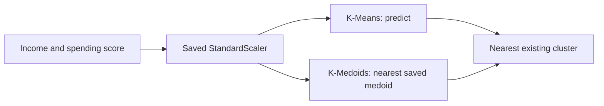

---

## 13. React frontend

A static, read-only analytics UI in `frontend/`: React 19 + TypeScript + Vite, styled with Tailwind CSS 4 and shadcn-style components (`components.json`, style `base-nova`) built on Base UI, with Recharts for charts.

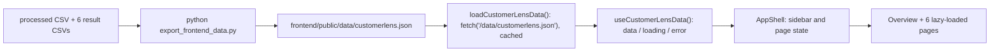

- **Data fetching:** one `fetch` of a static file, cached in a module variable. It is **not** a live Python API.
- **Navigation:** a sidebar with component state (`activePage`); there is no router library. Six pages are loaded with dynamic `import()`.
- **Loading / error / empty states:** `AppShell` shows `DataLoading` while loading and `DataError` (with the message) on failure or missing data. The Customer Explorer table has an explicit empty-results state. The JSON is cast to the TypeScript type without runtime schema validation.
- **JSON schema** (`frontend/src/data/customerlens.ts`):

| Key | Content |
|---|---|
| `meta` | project, dataset, `customer_count`, `optimal_k`, `cluster_features`, `algorithms` (customer count and K are hard-coded in the exporter) |
| `customers` | 200 records: raw columns + `KMeans_Cluster`, `KMedoids_Cluster`, `KMeans_Segment`, `KMedoids_Segment` |
| `algorithm_comparison` | rows from `final_algorithm_comparison.csv` |
| `kmeans_optimal_k`, `kmedoids_optimal_k` | nine rows each |
| `kmeans_profiles`, `kmedoids_profiles` | five rows each |
| `business_segments` | five rows from `final_business_segment_profile.csv` |

| Page | Content |
|---|---|
| Overview | KPI cards, segmentation map, cluster distribution and profile cards, dataset and feature summary |
| Data Quality | quality checks, gender and age distributions, income and spending distributions |
| Optimal K | selected K, silhouette and Davies-Bouldin curves, inertia and medoid-cost curves |
| Cluster Explorer | algorithm toggle, cluster filter, scatter plot, profile cards |
| Algorithm Comparison | silhouette and Davies-Bouldin charts, runtime chart, ARI, results table |
| Business Insights | segment distribution and profiles; a rule-based "recommended strategy" written in `BusinessInsights.tsx` |
| Customer Explorer | search, gender / cluster / segment filters, per-customer details for both algorithms |

**Known front-end caveats:** the runtimes and ARI are hard-coded in `AlgorithmComparison.tsx`; ARI is shown there as a percentage as well as 0.9597; `ClusterScatterChart.tsx` draws lines between points (`line` prop); the Business Insights recommendation text comes from thresholds in the TSX file, not from `segment_business_insights.csv`; `Overview` and `Cluster Explorer` display `Segment_Type` (see §11.4).

---

## 14. MCP server and optional utilities

None of this is required to run the analysis, the tests or either app.

`mcp-server/server.py` is a project-specific [MCP](https://modelcontextprotocol.io) server (`from mcp.server import MCPServer`, name "CustomerLens", version 1.0.0). It exposes **eight tools**:

| Tool | What it does |
|---|---|
| `project_status` | checks that nine expected files exist (including `notebooks/CustomerLens_OEP_Report.docx`, which is **not in this archive**; the report PDF is in `presentation/`) |
| `get_metrics` | returns the metrics stored in `frontend/public/data/customerlens.json` (does not recompute them) |
| `export_frontend_data` | runs `export_frontend_data.py` |
| `run_tests` | runs `pytest tests/test_clustering.py -v` |
| `run_frontend_checks` | runs the frontend build and lint with `npm.cmd` |
| `git_status` | reports `git status` |
| `final_audit` | combines the above; reports `READY` only if everything passes and the working tree is clean on `master`; with the nine-file check above it would report `NEEDS_ATTENTION` on this archive's layout (inferred from the code, not run) |
| `capture_dashboard_screenshot` | captures React dashboard screenshots through Playwright |

**Setup and assumptions**
- `mcp-server/requirements.txt` contains only `mcp[cli]>=2,<3`.
- `server.py` imports `screenshot_runner`, which imports **Playwright**. Playwright is **not listed in any requirements file**, so the server cannot start without installing it (and its browser) separately.
- The server calls `pytest` through the virtual environment's Python, so `pytest` must be installed there (it is not in `requirements.txt` either).
- It is **Windows-oriented**: it looks for `.venv\Scripts\python.exe` and calls `npm.cmd`. `mcp-config.example.json` hard-codes `D:\CustomerLens`; edit those paths and set `CUSTOMERLENS_ROOT` if your location differs.
- The React runner expects the dev server at `http://127.0.0.1:5173`; the Streamlit runner expects `http://127.0.0.1:8501`, so those apps must already be running.
- **Not executed in this audit.** The server and the screenshot runners were read but not run.

**Other utilities**
- `mcp-server/screenshot_runner.py` and `streamlit_screenshot_runner.py` write PNGs into `artifacts/screenshots/` and `artifacts/screenshots/streamlit/`.
- `mcp-server/ppt_asset_extractor.py` crops the Streamlit screenshots into `artifacts/ppt_assets/01_overview.png … 07_customer_explorer.png`. These names are **different from** the `01_dataset_overview.png … 09_customer_explorer.png` set made by `export_ppt_assets.py`.
- `skills/customerlens/SKILL.md` is a project guide for an AI assistant (project facts, reporting rules, safe workflow). It lists seven tools, while the server defines eight.

---

## 15. Installation and setup

**Prerequisites:** Python 3 (the project does not pin a version) and, for the frontend, Node.js `^20.19.0` or `>=22.12.0`.

```powershell
# 1. Get the repository (clone it, or extract the ZIP) and enter it
cd CustomerLens

# 2. Python environment
python -m venv .venv
.venv\Scripts\Activate.ps1
pip install -r requirements.txt

# 3. Test runner (not declared in requirements.txt)
pip install pytest

# 4. Frontend packages
npm --prefix frontend ci
```

Notes:
- `requirements.txt` is a full `pip freeze` that includes Windows-only `pywinpty`, so it targets Windows. In this archive it is saved as **UTF-16 LE with a byte-order mark**, not UTF-8. pip normally detects a BOM; if another tool fails to read it, re-save the file as UTF-8. The file was not installed in full during this audit.
- `npm --prefix frontend install` also works; `ci` installs exactly what `package-lock.json` records.
- Optional MCP setup: `pip install -r mcp-server/requirements.txt`, `pip install playwright`, then `playwright install chromium`.
- No environment variables are needed for the core project. `CUSTOMERLENS_ROOT` is read only by the MCP server.

---

## 16. How to run each component

Run these from the repository root unless noted.

| Goal | Command |
|---|---|
| Streamlit app | `streamlit run app.py` |
| React dev server (development mode, hot reload) | `npm --prefix frontend run dev` (Vite default <http://localhost:5173>) |
| React production build (static files in `frontend/dist`) | `npm --prefix frontend run build` |
| Preview the production build | `npm --prefix frontend run preview` |
| Frontend lint | `npm --prefix frontend run lint` |
| Python tests | `python -m pytest -q` |

The production build only bundles the React app into static files. It does not build, start or deploy any Python component, and the dashboard needs `customerlens.json` to be served alongside it.

---

## 17. Regenerating outputs and artifacts

| To regenerate | Run | Note |
|---|---|---|
| processed CSVs, result CSVs, model files, `artifacts/figures/` | open `notebooks/01_data_audit_and_eda.ipynb` from the `notebooks/` directory and run all cells (`jupyter lab`) | the notebook uses relative paths such as `../data/raw/…` |
| `frontend/public/data/customerlens.json` | `python export_frontend_data.py` | reads the CSVs, not the models |
| `artifacts/ppt_assets/01…09` | `python export_ppt_assets.py` | also re-creates the original `04_optimal_k.png` (no Davies-Bouldin curve) and, because of a name mismatch, a runtime panel that shows K-Means only (§20) |
| `04_optimal_k_corrected.png` | not produced by any script in the repository | redrawn from the two optimal-K CSVs |
| screenshots | the MCP-folder runners | see §14 |

**Reproducibility notes**
- K-Means uses `random_state=42` with 20 restarts; PAM is deterministic. In this audit the saved models were checked to reproduce the saved labels. The notebook's `pam_kmedoids` function was also executed separately during an earlier audit pass over a byte-identical copy of the notebook and reproduced the saved K-Medoids labels; the notebook was not run end to end.
- Models are serialised with joblib; unpickling on a different scikit-learn version raises an `InconsistentVersionWarning` (the models were saved with scikit-learn 1.9.1 according to the warning). Use the pinned version for a faithful reload.
- Re-running the notebook recomputes runtimes, but the values displayed by the applications stay hard-coded.
- Raw input must have the five columns in §4 with those exact names.

---

## 18. Testing and validation

`tests/test_clustering.py` has **eight tests** (run from the repository root, since `DATA_PATH` is relative):

| # | Test | Checks |
|--:|---|---|
| 1 | `test_dataset_exists_and_has_expected_size` | 200 rows, at least 5 columns |
| 2 | `test_required_clustering_features_exist` | feature list equals the two expected names and they exist in the data |
| 3 | `test_clustering_features_have_no_missing_values` | no missing values in those columns |
| 4 | `test_optimal_k_is_five` | `optimal_k == 5` in the saved config |
| 5 | `test_kmeans_model_has_five_clusters` | `kmeans.n_clusters == 5` |
| 6 | `test_kmedoids_model_has_five_medoids` | `k == 5` and five medoid indices/points |
| 7 | `test_kmeans_can_assign_all_customers` | labels for all 200 customers within 0–4 |
| 8 | `test_kmedoids_can_assign_all_customers` | nearest-medoid labels for all 200 within 0–4 |

They check stored configuration and assignment completeness. They do **not** check metric values, segment names or clustering quality.

**Historical status recorded by the project (not re-derived here):** 8 passed, frontend build passed, frontend lint passed.

**Executed during this documentation audit (against this archive):**

| Check | Outcome |
|---|---|
| `python -m pytest -q` with the repository's own model files | 8 passed (scikit-learn 1.8.0 was installed, so 4 `InconsistentVersionWarning` messages appeared) |
| `npm ci` (Node.js 22.22.2) | exit code 0 |
| `npm run lint` with `frontend/eslint.config.js` | exit code 0 |
| `npm run build` | exit code 0 |
| `app.py` loaded and all seven pages selected with Streamlit's `AppTest` (Streamlit 1.66.1) | 0 exceptions, 0 `st.error` on every page; deprecation warnings for `use_container_width` (used 38 times) |
| `python export_frontend_data.py` in a scratch copy | regenerated JSON identical to the shipped file |
| `python export_ppt_assets.py` in a scratch copy | runs; regenerates the figure set |
| Metrics recomputed from the model files and CSVs | match §10 and §11 |

**Not executed:** the Jupyter notebook end-to-end, the MCP server, the Playwright runners, `streamlit run` as a live server, `npm run dev`, and a full `pip install -r requirements.txt`. A different Python environment (Python 3.12 with pandas 3.0.2, NumPy 2.4.4, scikit-learn 1.8.0) was used instead of the pinned versions.

---

## 19. Academic relevance

CustomerLens exercises these data-mining topics, and only these: data audit and preprocessing, feature selection and scaling, exploratory data analysis, unsupervised learning, partition-based clustering with K-Means, medoid-based clustering with PAM, choosing the number of clusters, internal cluster-validity measures (silhouette, Davies-Bouldin), a partition-agreement measure (ARI), cluster profiling and visualisation. It does not implement hierarchical, density-based or model-based clustering, supervised learning, or any data-warehousing component such as ETL or OLAP. The mapping of these topics to specific syllabus units is not recorded in the repository and is not claimed.

---

## 20. Limitations and known issues

**Analytical limitations**
1. 200 customers and two clustering features; findings are exploratory and may not transfer.
2. Spending Score is a dataset-supplied behavioural score whose derivation is not documented.
3. Results depend on the chosen features, on `StandardScaler`, and on K = 5 (best-scoring evaluated K, picked from K = 2…10).
4. Silhouette and Davies-Bouldin are internal measures; there is no ground truth, so no accuracy exists.
5. Segment names and suggested actions are interpretations; no business impact has been measured.
6. Runtimes are one-run values with different timing scopes (§11.1).

**Documentation / software issues found in the repository**

| # | Issue | Where |
|--:|---|---|
| 1 | Cluster 0 (and cluster 4) labelled "Low Income - Low Spending" / "Low-Income / Low-Spending" in some places (§11.4) | `kmeans_cluster_profiles.csv`, React Overview and Cluster Explorer, `app.py` rule |
| 2 | `07_algorithm_comparison.png` shows runtime for K-Means only: the script looks up `"K-Medoids"` but the CSV name is `"K-Medoids (PAM)"`, so the value is NaN | `export_ppt_assets.py` |
| 3 | `06_cluster_profile.png` has a blank left half; `04_optimal_k.png` (regenerated by the script) has no Davies-Bouldin curve and plots inertia and medoid cost on one axis | assets, `export_ppt_assets.py` |
| 4 | `final_algorithm_comparison.csv` puts inertia and medoid cost in one `Objective` column (rounded to 4 d.p.), inviting a false comparison; it has no runtime or ARI | CSV, JSON `algorithm_comparison` |
| 5 | Runtimes, ARI, `customer_count` and `optimal_k` are hard-coded | `app.py`, `AlgorithmComparison.tsx`, `export_ppt_assets.py`, `export_frontend_data.py` |
| 6 | `OPTIMAL_K = 5` is typed in after the best-silhouette/DB K is printed | notebook |
| 7 | Streamlit and React use different naming schemes and different recommendation text | `app.py`, `BusinessInsights.tsx` |
| 8 | `use_container_width` is deprecated in Streamlit 1.66.1 (38 uses) | `app.py` |
| 9 | `requirements.txt` is an unpruned freeze (UTF-16 LE in this archive), lacks `pytest` and `playwright`, contains Windows-only `pywinpty` | root |
| 10 | The MCP server cannot start without Playwright and is Windows-specific; `SKILL.md` lists 7 tools vs 8 in the server | `mcp-server/`, `skills/` |
| 11 | Unused frontend dependencies (§5); `frontend/README.md` appears to be the stock Vite template text (only its opening was read) | `frontend/` |
| 12 | Two independent generators write into `ppt_assets/` with different file names | `export_ppt_assets.py`, `mcp-server/ppt_asset_extractor.py` |
| 13 | The `src/` package is empty; all logic lives in the notebook and `app.py` | `src/` |
| 14 | The notebook has no markdown cells, so the analysis has no in-notebook narrative | notebook |

---

## 21. Troubleshooting

| Symptom | Likely cause | Fix |
|---|---|---|
| `FileNotFoundError` for a `.joblib` or CSV when starting Streamlit or running tests | wrong working directory (paths are relative) or files missing | run from the repository root; regenerate with the notebook if files are missing |
| Notebook cannot find `../data/raw/Mall_Customers.csv` | Jupyter started outside `notebooks/` | start Jupyter inside `notebooks/` |
| `No module named pytest` | pytest is not in `requirements.txt` | `pip install pytest` |
| `InconsistentVersionWarning` when loading models | scikit-learn version differs from the one that saved them | install the pinned scikit-learn version |
| `pip install -r requirements.txt` fails on `pywinpty` | Windows-only package | use Windows or remove that line |
| `requirements.txt` looks like garbage in an editor | file is UTF-16 LE | re-save as UTF-8 |
| `npm` / Vite / ESLint errors about the Node version | Node.js too old | use `^20.19.0` or `>=22.12.0` |
| React page shows "Unable to load analytics" | `customerlens.json` missing or the app is not served from the Vite root | run `python export_frontend_data.py`; use `npm --prefix frontend run dev` |
| `ModuleNotFoundError: playwright` when starting the MCP server | Playwright is not declared anywhere | `pip install playwright` and `playwright install chromium` |
| Displayed runtimes differ from your notebook run | applications show hard-coded recorded values | expected |

---

## 22. Data attribution and acknowledgements

- **Dataset:** the Mall Customer Segmentation data in `data/raw/Mall_Customers.csv`. Per the team, it was downloaded from Kaggle: <https://www.kaggle.com/datasets/vjchoudhary7/customer-segmentation-tutorial-in-python> (*Customer Segmentation Tutorial in Python*, V. Choudhary). The repository files themselves contain no source reference, so this attribution rests on the team's statement. **No licence is stated here**; check the Kaggle page for its terms before redistributing the data.
- Course assignment: the brief also permitted the Yasserh Kaggle customer-segmentation dataset; the Mall dataset was used because it directly contains Annual Income and Spending Score.
- Methods: K-Means (MacQueen 1967; k-means++ by Arthur and Vassilvitskii 2007), PAM (Kaufman and Rousseeuw 1990), silhouette (Rousseeuw 1987), Davies-Bouldin (1979), ARI (Hubert and Arabie 1985), implemented with scikit-learn (Pedregosa et al. 2011).

---

## 23. Future improvements

*(None of this is implemented.)* Larger real-world customer data; additional behavioural features; temporal behaviour; one shared set of segment labels used by every interface; a script that retrains the models without the notebook; automated knee detection; storing runtimes and ARI in result files instead of in code; declaring `pytest` and `playwright` in requirements; deployment and monitoring.

---

## 24. Team

Division **III** · Department of Computer Engineering · SCET, Sarvajanik University

| Enrolment no. | Name |
|---|---|
| ET24BTCO176 | Mevada Drashtant Pareshkumar |
| ET24BTCO181 | Nirav Panwala |
| ET24BTCO170 | Priyanshu Makani |
| ET24BTCO185 | Merit Patel |
| ET24BTCO204 | Heet Sutariya |

Individual task allocation is not documented in the repository and is not stated here. The `presentation/` folder holds the project's OEP presentation (16 slides) and report PDF.
